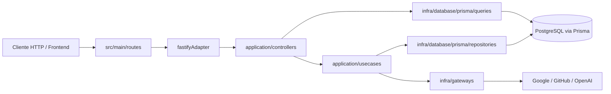

# Arquitetura

## Contexto arquitetural

O projeto e um backend HTTP em TypeScript com Fastify, organizado em camadas:

- `main`: bootstrap, rotas, middlewares e utilitarios de HTTP.
- `application`: controllers, use cases, entidades e erros da aplicacao.
- `domain`: contratos abstratos usados pela camada de aplicacao.
- `infra`: persistencia Prisma e gateways para servicos externos.
- `shared`: configuracoes, constantes e utilitarios compartilhados.
- `kermel`: registro simples de injecao de dependencias baseado em decorators.

Nao foi identificado frontend neste repositorio.

## Estilo arquitetural

O codigo segue um monolito modular com separacao por responsabilidade e uma adaptacao leve de Clean Architecture:

- rotas Fastify chamam controllers;
- controllers validam e transformam payloads;
- use cases e queries concentram regras de aplicacao;
- repositories encapsulam acesso a banco;
- gateways encapsulam chamadas externas;
- um registry proprio instancia dependencias via decorators.

## Pontos de entrada

- `src/main/server.ts`: inicia o servidor, escuta em `0.0.0.0` e faz shutdown gracioso.
- `src/main/app.ts`: registra plugins, rotas e tratamento global de erros.
- `prisma/schema.prisma`: define o schema do banco e o destino do Prisma Client gerado.

## Aplicacoes, modulos e responsabilidades

- `src/main/routes/auth/authRoutes.ts`: inicio de OAuth, callbacks, refresh token e sign out.
- `src/main/routes/github/githubRoutes.ts`: callback de instalacao do GitHub App e listagem de repositorios.
- `src/main/routes/report/reportRoutes.ts`: geracao de relatorio de repositorio GitHub.
- `src/main/routes/user/userRoutes.ts`: endpoint de usuario autenticado.
- `src/main/routes/repository/repositoryRoutes.ts`: listagem paginada e sincronizacao manual de repositorios persistidos.
- `src/main/routes/healthCheckRoute.ts`: health check simples.
- `src/main/routes/statusRoute.ts`: status tecnico com informacoes do banco.
- `src/application/adapters/fastifyAdapter.ts`: adapta controllers da aplicacao para Fastify.
- `src/application/controllers/**`: define contratos HTTP e mapeamento de entrada/saida.
- `src/application/usecases/**`: regras de negocio e orquestracao da aplicacao.
- `src/infra/database/prisma/**`: persistencia e consultas.
- `src/infra/gateways/**`: integracoes com JWT, GitHub App e OpenAI.
- `src/shared/config/env.ts`: validacao das variaveis de ambiente com Zod.

## Autenticacao e autorizacao

- Autenticacao baseada em JWT gerado por `@fastify/jwt`.
- O access token e armazenado criptografado em cookie HTTP-only `nexo-access-token`.
- O middleware `src/main/middlewares/ensureAuthenticated.ts` extrai o cookie, descriptografa com `src/shared/utils/Encryption.ts` e chama `request.jwtVerify()`.
- Refresh tokens sao persistidos na tabela `refresh_tokens`.
- Rotas privadas usam `ensureAuthenticated`; rotas publicas nao usam esse middleware.

## Persistencia

- Banco confirmado: PostgreSQL.
- ORM/camada de persistencia: Prisma 7.9.1 com `@prisma/adapter-pg`.
- Prisma Client e gerado em `src/infra/prisma/generated/prisma`.
- Repositorios confirmados: `UserRepository`, `RefreshTokenRepository`, `PrismaIntegrationRepository`, `PrismaRepositoryRepository` e `PrismaReportRepository`.
- Queries confirmadas: `GetMeQuery` e `GetRepositoriesQuery`.

### Modelo de dados confirmado

- `users`
- `refresh_tokens`
- `integrations`
- `repositories`
- `reports`
- `report_items`
- `usage_logs`

## Integracoes externas

- Google OAuth 2.0: troca de code por token e consulta de perfil.
- GitHub OAuth 2.0: troca de code por token e consulta de perfil/email.
- GitHub App: leitura de instalacoes, repositorios, commits, PRs, issues e detalhes de instalacao.
- OpenAI Responses API: gera o resumo textual do relatorio.

## Fluxos principais de dados

### Login Google/GitHub

1. O frontend solicita a URL de autenticacao.
2. O backend monta a URL OAuth.
3. O callback troca `code` por token externo.
4. O backend busca o perfil do usuario.
5. O usuario e vinculado por id externo ou por email.
6. O backend emite access token JWT e refresh token persistido.
7. O access token e gravado em cookie criptografado.

### Instalacao do GitHub App

1. O GitHub chama `GET /github/app/callback`.
2. O backend resolve o usuario do GitHub vinculado a instalacao.
3. A integracao GitHub do usuario recebe `installationId`.
4. O backend sincroniza os repositorios da instalacao para a tabela `repositories`.

### Geracao de relatorio

1. O usuario autenticado chama `POST /reports/github/generate`.
2. O backend valida periodo e identificador do repositorio.
3. O backend localiza a instalacao GitHub do usuario.
4. O backend coleta atividades do repositório via GitHub App.
5. O backend sintetiza um payload compacto.
6. O OpenAI gera o resumo.
7. O report e persistido junto com usage log.

### Sincronizacao de repositorios

1. O usuario instala ou atualiza o GitHub App.
2. O backend consulta os repositorios da instalacao autorizada.
3. Cada repositorio e gravado em `repositories` com `upsert` por integracao e `externalRepoId`.
4. A tela de repositorios passa a ler do banco filtrando pelo usuario autenticado.
5. Um endpoint manual de sync permite revalidar o snapshot local quando necessario.

## Comunicacao entre componentes

- A camada `application` depende de contratos e gateways, nao de Fastify diretamente.
- A camada `infra` implementa acesso a banco e a APIs externas.
- O registry `src/kermel/di/Registry.ts` usa metadata de constructor para resolver dependencias automaticamente.

## Areas criticas

- Autenticacao: cookie criptografado, JWT e refresh tokens.
- Integracao GitHub App: depende de `GITHUB_APP_ID` e chave privada base64.
- Geracao de relatorio: depende de OpenAI e do volume de dados coletado do GitHub.
- Persistencia: relatorio e usage log sao gravados em transacao.
- Status tecnico: executa queries diretas no PostgreSQL para medir conexoes.

## Riscos arquiteturais conhecidos

- Ha uso de `any` em partes do gateway GitHub e do callback de instalacao do app.
- `src/application/controllers/auth/GithubAppCallbackController.ts` usa `process.env.FRONTEND_URL` diretamente em vez do objeto de env compartilhado.
- `OpenAiGateway` falha na construcao se `OPENAI_API_KEY` estiver ausente, mesmo que a funcionalidade de relatorio nao seja usada.
- `PrismaIntegrationRepository.createOrUpdate` grava strings vazias para campos opcionais quando atualiza um registro sem valores novos.
- Nao foram identificados testes automatizados nem pipeline de CI/CD no repositorio.

## Dividas tecnicas confirmadas

- Ausencia de scripts repo-wide de lint e teste.
- Ausencia de estrategia padronizada de migrations no `package.json`.
- Ausencia de arquivo de configuracao de ambiente Node versionado.

## Caminhos relevantes

- `src/main/app.ts`
- `src/main/server.ts`
- `src/main/routes/*`
- `src/application/controllers/*`
- `src/application/usecases/*`
- `src/infra/database/prisma/*`
- `src/infra/gateways/*`
- `src/shared/config/env.ts`
- `prisma/schema.prisma`

## Quando atualizar este documento

Atualize este documento sempre que houver mudancas em:

- estrutura;
- modulos;
- comunicacao entre componentes;
- banco de dados;
- infraestrutura;
- autenticacao;
- integracoes arquiteturais;
- decisoes estruturais.
